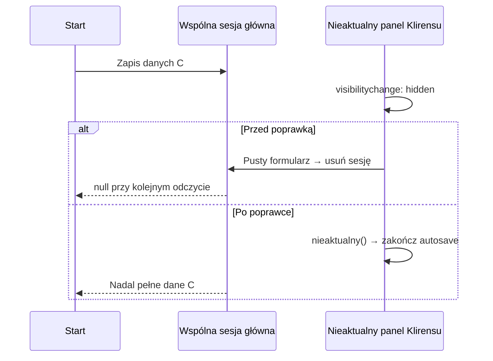

# Chip pacjenta i nawigacja powłoki

Analiza zgłoszenia z 2026-10-29, baza `audyt` `eee483016505f3267c61629af3db1216c5d79fe2`.
Dotyczy stanu zapisu pacjenta przy zmianie strony i odświeżaniu. Wszystkie próby
używają fikcyjnego sejfu w osobnym profilu przeglądarki.

## Co oznaczają kolory

| Stan | Wygląd | Znaczenie |
| --- | --- | --- |
| `saved` | zielony | Dane odpowiadają punktowi odniesienia po wczytaniu lub zapisie. |
| `dirty` | bursztynowy | Bieżące dane różnią się od tego punktu odniesienia. |
| `new_patient` | fioletowy | Formularz zawiera dane, ale wskaźnik nie zna zapisanego punktu odniesienia. |
| `hidden` | szary | Wskaźnik nie widzi danych pacjenta. |

Fioletowy nie dowodzi utraty rekordu w sejfie. W badanym kodzie może oznaczać
utratę samej referencji wskaźnika. Podobnie bursztynowy może wynikać z porównania
ustawień interfejsu, mimo że lekarz nie zmienił danych.

## Warstwy stanu

Każda ramka ma osobny formularz i osobny `VildaSaveStatusIndicator`. Ramki tej
samej karty współdzielą jednak `sessionStorage`, w tym identyfikator pacjenta,
sesję główną, sesję Klirensu i `vilda-save-ref-v1`. Ten ostatni klucz zawiera
odcisk odniesienia, znacznik zmian oraz metadane ostatniego zapisu. W powłoce
nagłówek hosta odzwierciedla wskaźnik wybranej ramki.

Przełączenie ramki nie wywołuje `pagehide`. Powłoka zapisuje więc stan strony
źródłowej przed przejściem, a stronę docelową odtwarza ze wspólnej sesji.
Odtworzenie formularza, odtworzenie pełnej sesji i wznowienie sejfu kończą się
w różnych momentach. Wskaźnik musi odróżniać taką inicjalizację od edycji.

## Ustalone przyczyny

### Klirens dopisuje ustawienia pustych kalkulatorów

Na bazowym kodzie: wczytanie zapisanego pacjenta na Start daje `saved` oraz
identyczny odcisk bieżący i referencyjny. Samo otwarcie Klirensu daje `dirty`.
Jedyną różnicą odcisków jest nowa sekcja `clcr.inputs` z domyślnymi kontrolkami,
bez nowych oznaczeń laboratoryjnych. Są to m.in. tryby wprowadzania
`concentration`, kontekst `general`, nieokreślone metadane `unknown` i domyślne
24 godziny zbiórki z pochodzeniem `assumed-24h`.

Domyślne ustawienia trafiają do wspólnej sesji Klirensu, dlatego fałszywa zmiana
przetrwa F5 i powrót na Start. Samo poprawienie koloru nagłówka nie usuwa przyczyny.
Porównanie musi traktować brak kalkulatora i jego puste ustawienia domyślne
jednakowo. Ręcznie podany czas zbiórki, jego pochodzenie, odmienne ustawienia
i rzeczywiste oznaczenia nadal muszą uczestniczyć w porównaniu.

Dotyczy to także nowego formularza fosforanów z aktualnej bazy: pusty tryb
stężenia, założone 24 godziny i dokładna flaga `PO4_durationNeedsConfirmation`
równa `false` są ustawieniami interfejsu. Oznaczenie, objętość, wynik wpisany
ręcznie, przeliczenia jednostek, potwierdzenie i historycznie brakujący czas
nadal uczestniczą w porównaniu.

### Lokalny `hidden` może usunąć wspólną referencję

W bazowej funkcji `B()` wskaźnika gałąź `hidden` z niepustymi danymi woła
`N()` przed odczytaniem istniejącej referencji. `N()` usuwa współdzielony
`vilda-save-ref-v1`, po czym wskaźnik przechodzi do `new_patient`.
Stan pojedynczej, jeszcze nieodtworzonej ramki może więc zniszczyć informację
o zapisie całej karty.

Ścieżkę usuwania potwierdza regresja uruchamiająca rzeczywisty kod wskaźnika
z dwoma dokumentami i wspólnym magazynem, zarówno dla danych zapisanych, jak
i rzeczywiście zmienionych. Osobna kontrolowana próba przeglądarkowa po
wywołaniu `_forceTransition('hidden')` potwierdza stos `U → N → B → ue`.
W początkowych sześciu próbach
samego F5 na Start nie wystąpił naturalnie fioletowy stan; nie są one dowodem
wykluczającym wyścig odtwarzania.

### Powłoka kopiuje stan bez odpowiadającej mu referencji

Bazowe `ct()` kopiuje klasę i opis z aktywnej ramki do nagłówka, a dodatkowo
wywołuje `_forceTransition()` w ukrytych ramkach. Nie przekazuje im przy tym
odcisku odniesienia ani metadanych. Powstaje rozbieżność między wyglądem,
wewnętrznym stanem i punktem odniesienia ramki.

Przy ponownym zapisie tego samego pacjenta stara ramka może zachować dawny
odcisk: bazowy słuchacz `vilda:persist-restored` odświeża go tylko po zmianie
identyfikatora pacjenta. Zmiana wersji lub zapis wizyty tego samego pacjenta
też wymagają przejęcia aktualnej referencji.

### Osiem tras nie ma własnego wskaźnika

Wskaźnik formularza istnieje na Start, DocPro i Klirensie. Pozostałe osiem tras
powłoki go nie ładuje. Bazowe `ct()` usuwa wtedy klasę statusu z nagłówka,
a proxy zwraca `hidden`. Potwierdzono to w przeglądarce na HOMA: nazwa pacjenta
pozostaje w nagłówku, natomiast okno chipa pokazuje „Brak danych pacjenta”.
Identyfikator i zapis w sejfie nie zmieniają się.

Ten sam brak występuje przy samodzielnym otwarciu tych stron, bez powłoki.
Kontrolowany przebieg na plikach bazowego commita obejmuje 11 dokumentów tras
i F5 każdego: Start i DocPro zachowują zapis, osiem stron nie pokazuje statusu,
a Klirens zgłasza fałszywe zmiany. We wszystkich 22 punktach kontroli pacjent
oraz snapshot w sejfie pozostają te same.

### Starsza kopia Klirensu przywraca świadomie usunięty wynik

Rzeczywisty test wpisuje kreatyninę `0.8`, sprawdza `dirty`, odświeża stronę,
a następnie usuwa tę wartość. Bezpośrednio po usunięciu formularz i dedykowana
sesja Klirensu mają puste `Scr`. Sesja główna zachowuje jednak stare `Scr=0.8`.
Przy następnym przejściu na Start odtworzenie wpisuje tę starszą kopię do
dedykowanej sesji: wraca zarówno wynik, jak i bursztynowy stan chipa.

Przyczyną jest uzupełnianie pustych pól sesji głównej poprzednimi wartościami
na stronach bez `#intakePal`. To uzupełnianie służy zachowaniu pól innych stron,
ale dla dedykowanej sekcji Klirensu odtwarza też świadomie usunięte wejścia.
Dedykowana sesja musi być autorytatywna przy zapisie jej kopii w sesji głównej.
Jawne wczytanie pacjenta lub odtworzenie zapisu nadal przyjmuje wybrany rekord.

### Powiadomienie o zapisie innej karty zatwierdza bieżący formularz

Wywołanie rzeczywistego słuchacza `onPatientSaved` po zapisie pacjenta B
ustawiało `saved` także w niezapisanym formularzu pacjenta A. Referencja
otrzymywała przy tym metadane B. Powiadomienie musi być przypisane do pacjenta;
nieaktualna ramka również nie może ustanawiać wspólnej bazy.

### Nieaktualny panel usuwa sesję podczas ukrywania

Celowana próba rzeczywistego pickera Klirensu uchwyciła fizyczne usunięcie
sesji głównej 69 ms po poprawnym zapisie pacjenta C na Start. Sprawcą był
pusty, nieaktualny panel Klirensu: jego właściciel był `null`, protokół zgłaszał
`nieaktualny() === true`, a wybranym pacjentem pozostawał C. Stos wywołania:
`visibilitychange → Kt → oe → re → clearMainSession → Storage.removeItem`.

Adapter odrzuca zapisy nieaktualnych paneli, lecz autosave wcześniej sprawdzał
znaczenie pustego formularza i przechodził bezpośrednio do usunięcia sesji.
Późniejszy poprawny zapis czasem odtwarzał sesję; końcowy stan tej kontrolowanej
próby był nawet zielony, mimo potwierdzonego usunięcia i przejściowych odczytów
`null`. Wyjaśnia to nieregularność objawów i potrzebę deterministycznego testu
zdarzenia ukrywania, poza sprawdzaniem samego stanu końcowego.

Autosave odrzuca teraz nieaktualny panel przed oceną pustego formularza.
Jawne czyszczenie sesji oraz globalne czyszczenie przy blokadzie/wylogowaniu
zachowują dotychczasowy kontrakt; nie dodano ogólnej blokady do adaptera.

### Wczytanie na DocPro pomija pola innych kart

Pełny zapis pacjenta C na Start, wczytanie B, a następnie ponowne wczytanie C
na DocPro ujawniło odrębną przyczynę. DocPro nie ma kontrolek wszystkich kart
Start. Pierwszy zapis sesji nowego pacjenta nie zachowywał jego niewyświetlanych
pól, m.in. PAL, tętna i kontekstu oddechowego. Powrót na Start i F5 uzupełniały
je ustawieniami kontrolek, zmieniając odcisk bez edycji.

Pierwszy zapis korzysta teraz z kopii właśnie wczytanego C, przypisanej do
konkretnej operacji. Zachowuje wyłącznie pola, których bieżący dokument nie
posiada; pola własne formularza, także puste, pozostają autorytatywne. Nie może
uzupełnić C starszymi danymi B. Kolejne zapisy zachowują ten sam podział
własności, historie oraz dedykowane sesje.

Pełny zestaw E2E wykrył też regresję pierwszej wersji tej poprawki: ponowne
wczytanie tej samej osoby na DocPro usuwało nowsze potrawy z bieżącej sesji,
gdy zapisany rekord miał tylko pusty wrapper kontrolek spożycia. DocPro nie
ma ich edytora. Taki dokładnie pusty wrapper albo brak sekcji zachowuje teraz
potrawy ze zgodnej sesji tej samej osoby. Niepuste potrawy wczytanego rekordu,
jawne wyczyszczenie oraz kontrolki strony posiadającej edytor pozostają
autorytatywne. Inna tożsamość lub niezgodna data urodzenia blokują ten wyjątek;
nie stosuje się go do PAL, historii ani pozostałych sekcji.

Dla starszego rekordu bez PAL brakującą wartość wyznacza istniejące API planu
i spożycia. Nie dodano nowego wzoru ani stałej medycznej. Wybór „Nowy pomiar”
może zmienić automatyczny PAL, bo usuwa antropometrię: wartość wytworzona przez
ten import musi zostać ponownie uzgodniona przed ustanowieniem referencji.
Istniejący PAL rekordu i ręczny wybór nie są zastępowane tym mechanizmem.

### Puste pola po nowym pomiarze i brak daty urodzenia

Rozgrzany Start pomijał odtwarzanie skalarów równych `null`. Po „Nowym pomiarze”
sesja miała pustą masę i wzrost, ale DOM mógł nadal pokazywać poprzedni pomiar.
Odtworzenie rozróżnia teraz brak pola w starszym formacie od jawnego `null`
lub pustego tekstu, który ma wyczyścić kontrolkę. Zero pozostaje wartością.

Zmiana pacjenta B z datą urodzenia na C bez daty nie resetowała kontrolki DOB
przed zastosowaniem C. Moduł wieku mógł więc użyć daty B zamiast ręcznego wieku C.
Jawny import resetuje DOB przez istniejącą funkcję przed odtworzeniem nowego
rekordu. Odtwarzanie tej samej sesji zachowuje wpisaną datę.

### Archiwum „Nowego pomiaru” trafia do innego modelu niż kolektor

Pełne scenariusze DocPro ujawniły kolejną rozbieżność: po „Nowym pomiarze”
historia zaawansowana zawierała poprzedni bieżący punkt, a referencja historii
podstawowej jeszcze go nie miała. Dopiero Start/F5 dopisywał go również do
sesji głównej, zmieniając chip na `dirty`.

Odczyty po obsłudze wyboru potwierdziły: kopia archiwizacji i globalny alias
`growthBasicData` miały wiersze 120 i 160 miesięcy, natomiast używany przez
kolektor `basicGrowthData` oraz sesja główna nadal miały tylko wiersz 120.
Skrypt aktualizował niewłaściwy alias. Na Start model otrzymywał oba wiersze,
a zapis sesji dopiero przy odświeżeniu ujawniał różnicę.

Poprawka aktualizuje właściwy model oraz domyka jego jeden zapis po zdarzeniu
wyboru, przed ustanowieniem referencji przez SSI. Istniejąca funkcja archiwizacji
dopisuje poprzedni punkt do najnowszej historii podstawowej. Niezależne wiersze
pozostają zachowane; jawne wyczyszczenie nie może odtworzyć starszych wierszy
z rekordu źródłowego. Transakcja jest przypisana do pacjenta, sekwencji i
aktualnej podstawy zapisu, a ponowienie po nieudanym zapisie nie może nadpisać
historii zmienionej w międzyczasie.

### Domyślne kontrolki Start i metadane sejfu w odcisku

Puste karty materializują także dokładnie określone domyślne ustawienia Start:
wytyczną ESC, populację zdrową i kontekst oddechowy healthy/awake. Projekcja
porównawcza utożsamia je z brakiem tych ustawień; odmienne wartości pozostają
porównywane. PAL nadal uczestniczy w porównaniu.

Pola techniczne rekordu sejfu `_contentAtISO`, `_pinnedState` i `_pinned`
mogły trafić do pierwszej sesji, a zniknąć po F5. Są pomijane wyłącznie na
kopii do porównania, tak samo dla bieżącej i starszej referencji. Nie zmienia
to zapisu, eksportu ani przypięcia rekordu.

### Sesja ma dane, których formularz Start nie odtworzył

Samodzielny picker Klirensu i późniejsze wejście na Start ujawniły brak
odtwarzania kontrolek tętna, ciśnienia i oddechów z sesji głównej. Klirens nie
ma tych kontrolek, więc nie zapisuje ich także w mapie pól wspólnego runtime.
Sesja główna zawiera dane C i chip początkowo pokazuje `saved`, lecz formularz
Start nadal ma puste wartości. Kolejny zapis strony zastępuje nimi dane C,
a F5 ujawnia różnicę. Przywrócenie musi objąć właściwe kontrolki przed pierwszym
zapisem; sama obecność sekcji w JSON nie oznacza odtworzenia formularza.

Podobnie obecność globalnego modelu historii nie oznacza własności danych.
Start, DocPro i Klirens ładują część tych samych skryptów, choć tylko niektóre
strony mają tabele wzrastania lub spożycia. Skrypt może zainicjować globalne
`null`/`[]` bez takiej tabeli. Odtworzenie nie może potraktować tego jako
świadomego usunięcia historii. Warunek własności musi odpowiadać kontenerowi
edytora lub autorytatywnemu odczytowi właściwego modułu.

Macierz sprawdza dane również po każdym przejściu przygotowującym i powrocie
na Start, przed kolejnym zapisem. Zapis kontrolny nie może zatwierdzić historii,
która zniknęła już podczas przygotowania scenariusza.

## Kontrakt poprawki

- Nawigacja i odtworzenie odczytują wspólną referencję; nie ustanawiają nowego
  zapisu i nie zapisują starego formularza ukrytej ramki.
- Publikacja jest przypisana w pamięci do pacjenta, sekwencji i generacji
  operacji. Zapis tego samego pacjenta w innej ramce odświeża zarówno odcisk,
  jak i numer oraz czas zapisu.
- Lokalne `hidden` nie usuwa wspólnej referencji. Jawne czyszczenie i blokada
  sejfu zachowują własne ścieżki unieważniania.
- Powłoka wybiera gotowy wskaźnik właściwego pacjenta również na trasie bez
  własnego formularza. Nie wymusza stanów ukrytych wskaźników.
- Domyślne kontrolki Klirensu są normalizowane wyłącznie na kopii do porównania.
  Formularz, sesja, eksport, pochodzenie danych i obliczenia pozostają bez zmian.
- Rzeczywiste zmiany nadal dają `dirty`, także po nawigacji i F5. Uzgadnianie
  odtworzenia nie może anulować oczekującej obsługi rzeczywistej edycji.
- Wskaźnik doładowany na stronie bez formularza działa wyłącznie jako odbiorca.
  Nie zapisuje ani nie usuwa wspólnej referencji i nie zatwierdza danych po
  powiadomieniu o zmianie karty pacjenta. Host powłoki zachowuje własne proxy.

## Zakres sprawdzenia

Powłoka deklaruje 11 tras: Start, DocPro, Klirens, HOMA, Steroidy, Lab,
Notatki, Terminarz, Ustawienia, Materiały edukacyjne i Cukrzyca. Zakres regresji
obejmuje zimne otwarcie, F5 aktywnej trasy, przejścia pomiędzy rozgrzanymi
trasami, Wstecz/Dalej, nawigację z menu i rzeczywistą edycję danych.
Test macierzy wykonuje wszystkie 110 skierowanych przejść między różnymi
trasami. Osobne scenariusze wczytują rekord na DocPro w trybach „Odtwórz”
i „Nowy pomiar”, po czym wracają na Start i wykonują F5. Obejmują także starszy
rekord bez PAL oraz zachowanie pustych pomiarów i niezmienionego sejfu.
Instrukcje, dokumenty prawne i strony informacyjne otwierane poza tą listą
nie są dodatkowymi panelami powłoki. Repozytorium ma 22 główne dokumenty HTML:
host i 21 stron samodzielnych. Wszystkie używają mostka sesji, który na stronach
bez własnego wskaźnika doładowuje jego wersję tylko do odczytu po gotowości auth.

Wyniki końcowych sprawdzeń i dokładny commit są podawane w PR. Zmiana nie
wprowadza nowych wzorów, norm, jednostek ani interpretacji klinicznych.

## Aktualizacja PWA — dalsza analiza z 29.10.2026

Po scaleniu #823 sprawdzono bieżący `audyt` `989830ce` oraz opublikowany
service worker 1.1.411. Aktualizacja z pacjentem nie była objęta wcześniejszymi
testami PWA: badały one instalację, cache, offline i baner bez powiązania
z referencją zapisu pacjenta. Odtworzono dwa odrębne mechanizmy.

### Starsza referencja domyślnej zbiórki

Rzeczywisty serializer oraz SSI z `eee48301` zapisują po resecie formularza
`CA/MG/UA_collectionHours: ''` z `collectionSource: 'assumed-24h'`. Historyczna
kanonizacja usuwała puste godziny, zostawiając samo pochodzenie. Obecny
serializer materializuje istniejące domyślne 24 h; projekcja SSI usuwa ich
parę, ale wcześniej nie usuwała osieroconego pochodzenia starej referencji.
Przy niezmienionym `Scr: '0.4'` porównanie po aktualizacji dawało `dirty`.

Projekcja na kopii utożsamia teraz dokładne `assumed-24h` z brakującymi lub
pustymi godzinami, jeśli nie ma wymaganego potwierdzenia. Historycznie brakujący
czas, ręczny czas, niepoprawne wartości, badania i rozszerzenia pozostają
porównywane. Referencja nie jest resetowana ani zastępowana bieżącymi danymi.
Mała fikcyjna fixture zawiera wynik rzeczywiście wydanych modułów i ich SHA256:
`tests/fixtures/save-status-pre-823-duration.json`. Regresja wykonuje obecny
serializer, model czasu i SSI w `save-status-update-migration.test.mjs`.

### Zamykane ramki tego samego pacjenta nadpisują nowszą sesję

Prawdziwy przebieg: rozgrzanie DocPro i Klirensu, powrót na Start, zapis 47 kg,
kliknięcie „Aktualizuj”. Przed aktualizacją chip był `saved`. Przy zamykaniu
Start zapisał sesję z `user.measuredAtISO: '2026-10-29'`, po nim DocPro również
zachował datę, a ukryty Klirens jako ostatni zapisał ją bez tej daty. Jego PID
był zgodny z PID karty, więc dotychczasowy strażnik innego pacjenta pozwolił na
zapis. Referencja zachowała datę, bieżąca sesja ją straciła i chip stał się
`dirty`. Następne F5 odtworzyło datę i stan `saved`.

Deterministyczna kontrola rzeczywistych modułów potwierdza także utratę wejść:
ukryty formularz z ciśnieniem 118 nadpisuje zapisane 120. Sama zgodność PID
nie dowodzi więc, że formularz jest najnowszym właścicielem całej sesji.
Zaobserwowany przebieg nie wymaga osobnego reloadu każdej ramki: wystarcza
zamknięcie ich w różnej kolejności przez przeładowanie hosta.

Aktualizację koordynuje teraz `VildaShell.reloadForAppUpdate()`:

1. Gotowy, bieżący aktywny panel zapisuje stan wspólny i sesję główną.
2. Flaga w pamięci hosta blokuje publikację ze wszystkich zamykanych ramek,
   także tego samego pacjenta, przez istniejący protokół `VildaPanelPacjent`.
3. Host przeładowuje się raz; ramki delegują do niego `controllerchange`.
   Tę samą drogę stosuje zapasowy reload banera.

Ten sam błąd potwierdzono przy zwykłym F5 na poprawionej wcześniej ścieżce PWA:
BP 120 cofało się do 118 i znikała data pomiaru. Przygotowanie jest więc także
wywoływane przez `host.pagehide`, bez zlecania kolejnego reloadu. W rzeczywistym
Chromium kolejność była: host `beforeunload`, dzieci `beforeunload`, host
`pagehide`, dzieci `pagehide`. Zapis aktywnego panelu w `host.pagehide` naprawia
wcześniejszy wpis stanu wspólnego i poprzedza blokadę dziecięcych zapisów sesji.
Samo anulowane `beforeunload` nie włącza blokady. Powrót z BFcache zdejmuje ją
w `pageshow.persisted` przed dotychczasową obsługą pokazywania panelu.

Aktywna strona bez formularza nie wymusza zapisu ukrytego Startu. Formularz
nieodtworzony, zablokowany lub nieaktualny nie zapisuje częściowego DOM.
Wyjątek nawigacji zdejmuje tymczasową blokadę; rzeczywista własność pacjenta
zachowuje swój wcześniejszy kontrakt. Pierwsze przejęcie przez SW nadal nie
przeładowuje strony. Strona samodzielna i starsza powłoka zachowują dotychczasowy
mechanizm. Nie powstają nowe klucze storage ani nowy punkt odniesienia zapisu.

### Pierwsze przejście z już otwartego starego klienta

Osobna próba serwowała rzeczywisty kod `989830ce` i SW 1.1.411, a następnie
roboczy klient poprawki z prawidłowo podbitymi `?v=` i testowym SW 1.1.412
(przed późniejszą integracją #827). Stary, już uruchomiony
klient zdążył podczas zamykania nadpisać sesję: BP 120 → 118 i usunięcie daty
29.10.2026. Nowa wersja uruchomiła się z takim formularzem; stary cache został
usunięty, referencja i PID pozostały identyczne. W tej próbie `dirty` odpowiada
rzeczywistej zmianie danych sesji, mimo braku edycji przez użytkownika.

Nowy kod nie może wstecznie zmienić listenerów działającego starego dokumentu.
Pierwszą instalację poprawionego klienta należy więc wykonać po zakończeniu
pracy z pacjentem i przed ponownym wczytaniem wizyty. Nie dodano automatycznego
odtwarzania z sejfu ani ustanawiania nowej referencji, które mogłyby usunąć
autentyczne niezapisane edycje albo zatwierdzić nadpisane wejścia.
Dowód tej pierwszej migracji obejmuje sesję, DOM, referencję, PID i cache;
sonda nie odczytywała snapshotów sejfu po aktualizacji. Pełne porównanie
snapshotów sejfu przed i po jest asertowane w nowych testach przeglądarkowych.

Test integracyjny `patient-status-pwa-update-lifecycle.test.mjs` używa pełnej
powłoki, rzeczywistych modułów zapisu i funkcji `controllerchange` oraz watchdog
odczytanych z AST artefaktu. Test przeglądarkowy
`patient-status-pwa-update.spec.mjs` używa osobnego serwera dla każdej próby,
pełnego produkcyjnego SW i rzeczywistego banera. Sprawdza zapisane oraz faktycznie
zmienione dane w powłoce i samodzielnie, a także zwykłe F5 rozgrzanej powłoki,
z zachowaniem snapshotów sejfu. Testy aktualizacji wykonują nowego klienta
przechodzącego na kolejny SW; nie stanowią dowodu retroaktywnej ochrony
listenerów starego klienta. Historyczny odcisk bada osobny test migracji.

## Bieżąca decyzja przed wyczyszczeniem i wczytaniem

Szybkie kliknięcie „Wyczyść wszystkie pola” po edycji może poprzedzać zapis
sesji i odświeżenie wskaźnika. Potwierdzona regresja dotyczyła formularza
z samymi danymi pokwitania: wpisane pola zostały wyczyszczone, gdy zapamiętany
stan wskaźnika nadal miał wartość `hidden`.

`VildaSaveStatusIndicator.getCurrentDecision()` odczytuje w chwili działania
aktualne dane oraz zakres konta, pacjenta i operacji odtwarzania. Zwraca
`{ready, state, scope}`. Wskaźnik w nagłówku zachowuje dotychczasowy mechanizm
odświeżania i kanonizację; odczyt decyzji nie ustanawia referencji zapisu.

Osobny `captureCurrentUserDataReadOnly({base})` używa bieżących pól należących
do danego dokumentu lub modułu. Nieobecne edytory zachowują dane ze sprawdzonej
bazy tego samego pacjenta, a jawne puste wartości własnych pól pozostają
wyczyszczeniem. Dotyczy to również częściowych widoków DocPro i Klirensu.
Odczyt korzysta z osobnych ścieżek Klirensu, oceny pokwitania, wieku kostnego
i danych urodzeniowych SGA: nie zapisuje sesji, nie publikuje referencji,
nie tworzy kotwic obserwacji i nie zmienia kontrolek. Brak wybranej wersji
Klirensu pozostaje odczytywalnym stanem, także po zwinięciu wersji
z zachowaną formułą; odczyt nie wybiera domyślnego wzoru. Selektor wzoru
jest odczytywany z bieżącego dokumentu, ponieważ interfejs Klirensu celowo
przenosi go do paska przed formularzem. Zwykły serializer zapisu zachowuje
swój dotychczasowy kontrakt.

Guard używa tej samej decyzji przy przechwyceniu kliknięcia i otwieraniu
dialogu. Przed odrzuceniem sprawdza ponownie właściciela oraz treść formularza.
Sam brak gotowości podczas odtwarzania lub zapisu anuluje bieżącą akcję
z krótkim komunikatem; nie uruchamia później samoczynnego czyszczenia.
Dotychczasowe zachowanie formularza gościa pozostaje zachowane.

„Zapisz i wyczyść” wymaga receipt konkretnego zakończonego zapisu, a nie
dowolnego zdarzenia `onPatientSaved` lub samego rozwiązania Promise.
`saveUserDataWithReceipt()` korzysta z tego samego pipeline co zwykły zapis;
niepowodzenie, zmiana zakresu i obcy zapis nie potwierdzają tej operacji.
Odpowiedź poprzedniego konta nie publikuje PID ani referencji w nowym kontekście.

Po własnym poprawnym zapisie guard czeka na rzeczywiste zakończenie
odtwarzania DOB (`vilda:dob-restored`), zachowując jeden limit ośmiu sekund,
a następnie sprawdza konto, pacjenta i treść. Dozwolone przypisanie nowego PID
dotyczy wyłącznie potwierdzonego własnego zapisu oraz tej samej wizyty.
Spóźniona odpowiedź, zmiana danych lub konta nie uruchamiają starego Clear.

Regresje obejmują opóźnione rzeczywiste callbacki sesji i wskaźnika, dane
pokwitaniowe bez antropometrii, anulowanie i odrzucenie, własny zapis,
obce potwierdzenie, zmianę konta oraz niezmienione dane w powłoce i na
stronach samodzielnych. Nowe scenariusze są w
`tests/e2e/clear-current-state.spec.mjs`; istniejące asercje resetu panelu
pokwitania pozostają częścią sprawdzeń. Wzory, normy i interpretacje nie
są zmieniane przez tę poprawkę.
